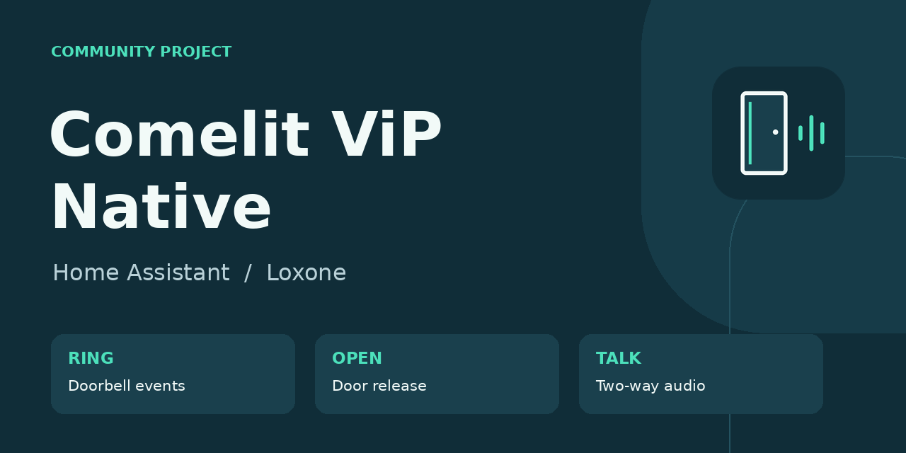

# Comelit ViP Native

**Doorbell events, door release and two-way Loxone audio for a native Comelit ViP installation.**

[Deutsch](README.de.md) · [Setup](docs/en/setup.md) · [Compatibility](docs/COMPATIBILITY.md) · [Security](SECURITY.md) · [Changelog](CHANGELOG.md)

A community Home Assistant integration for the native UDP/CTP path. The local connection runs on Home Assistant. An optional Asterisk app connects external Loxone audio through Antisip. No Comelit PC client or USB license key is used.

**Status: community beta.** The underlying 0.1.12 integration and 0.1.1 audio gateway were reported working on one UT8020 + TP6842 installation on 18 October 2026, including external Loxone audio. This 0.2.0b1 package adds publication, configuration and presentation changes. It has not yet been field-tested as a separate release. Other devices, firmware and NAT combinations are unverified.

| Feature | Included |
| --- | --- |
| Ring detection | HA event, binary sensor and optional UDP forwarding to Loxone |
| Door release | HA button; usable from Loxone, including during an owned call |
| Local two-way audio | Loxone SIP → HA → native ViP |
| Start a conversation without ringing | From Loxone while the line is free |
| External audio | Optional Antisip/Asterisk app; router and provider dependent |
| HA listening card | Accept, listen and hang up; playback only |
| Camera stream | Configure an existing camera separately; no camera entity or video proxy here |

## Start here

1. Read [compatibility and prerequisites](docs/COMPATIBILITY.md).
2. Follow the [setup guide](docs/en/setup.md). Start with local registration and ringing.
3. Add Loxone door release and local audio.
4. Optionally enable external audio after reading the access model below.

After publication, HACS users add `https://github.com/boeckii69/comelit-vip-home-assistant` as a custom repository of type **Integration**. The optional audio app uses the **same URL** in the Home Assistant app store. HACS installs the integration only. This project is not claimed to be included in the default HACS catalog.

Requires Home Assistant **2026.3+** for the community package and its bundled integration artwork. The audio app supports HA OS / Supervisor on **amd64** and **aarch64**; ordinary HA Container installations do not have the Supervisor app store.

## External audio: know who can call

**Automatic mode does not authenticate individual Loxone users. Anyone who knows the Antisip SIP address can call and activate audio.** The gateway key authenticates the local app to HA, not the remote caller. Automatic mode is off by default. Manual mode grants the next valid external call for 30 seconds; it does not bind that grant to a named person either. Choose the mode deliberately.

One simultaneous conversation is supported. Local phones are admitted by exact LAN IPv4 addresses. A SIP call never releases the door; door release remains a separate authenticated HA action. SIP TLS does not make the RTP audio end-to-end encrypted. See [SECURITY.md](SECURITY.md).

## Contribute what you learn

Device/firmware reports, reproducible bug reports, translations and reviewed protocol improvements are welcome. [Contributing](CONTRIBUTING.md) explains the test setup and the evidence required for a compatibility report. Do not post tokens, SIP passwords, gateway keys, home screenshots or raw recordings.

## Credits and license

Project code and original artwork are MIT licensed. The CTP codec is derived from [jfmlima/comelit-vip](https://github.com/jfmlima/comelit-vip), copyright Jorge Lima; its MIT notice ships with the integration. See [LICENSE](LICENSE), [THIRD_PARTY_LICENSE.txt](THIRD_PARTY_LICENSE.txt) and [NOTICE.md](NOTICE.md). Asterisk and the container's operating-system packages retain their own licenses.

Independent community project; not an official product of Comelit, Loxone or Home Assistant. Product names identify the systems this project connects.
